# Hesham Ebaid

**AI/ML Engineer · Researcher · Teaching Assistant**

*Building intelligent systems with deep learning, computer vision, NLP, and real-world AI.*

---

## About Me

I am an **AI/ML Engineer, researcher, and Teaching Assistant** working across **deep learning, computer vision, natural language processing, and intelligent systems**.

I enjoy building end-to-end solutions that move beyond experimentation into practical, reliable systems. My work spans machine learning research, computer vision pipelines, real-time AI, signal processing, and applied software engineering.

Alongside my engineering and research work, I work as a **Teaching Assistant at E-JUST**, where I support undergraduate students in programming, mathematics, embedded systems, and operating systems.

**Current focus:**  
AI/ML · Computer Vision · NLP · Deep Learning · Real-Time AI · Research & Education

---

## Experience

### AI/ML Engineer

Building and deploying real-world AI systems with a focus on:

- Computer vision and object detection
- Real-time inference and video analytics
- Deep learning model development and optimization
- End-to-end machine learning pipelines
- Production-oriented AI systems

### Teaching Assistant — E-JUST

Supporting undergraduate students across technical and engineering courses, including:

- Programming
- Advanced Mathematics with Software Applications
- Advanced Embedded Systems
- Operating Systems
- xv6 and systems programming

I enjoy teaching because it allows me to combine engineering, research, and education while helping students develop strong technical foundations.

---

## Technical Stack

### Programming Languages

  

### AI · Machine Learning · Computer Vision

  
  
  
  

### Web · APIs · Software Engineering

  
  
  
  

### DevOps · Systems · Tools

  

---

## Research Interests

My research interests sit at the intersection of **AI, perception, signal processing, and intelligent systems**.

- **Computer Vision** — object detection, segmentation, visual understanding, and real-time inference
- **Medical AI** — deep learning for diagnostic imaging and biomedical signal processing
- **Natural Language Processing** — transformers, information extraction, and Arabic NLP
- **Deep Learning** — representation learning, generative models, and model optimization
- **Intelligent Systems** — applying AI to real-world engineering and automation problems

---

## GitHub Statistics

&nbsp;&nbsp;

 

 

---

## GitHub Metrics

 

&nbsp;

---

## Current Interests

- Building reliable and scalable AI systems
- Computer vision for real-world applications
- Multimodal and vision-language models
- Medical AI and biomedical signal processing
- Arabic NLP and language technologies
- AI research and graduate studies
- Teaching and technical education

---

## Let's Connect

I'm always interested in **AI/ML research, computer vision, NLP, intelligent systems, and meaningful technical collaborations**.

Feel free to connect with me on [LinkedIn](https://www.linkedin.com/in/hesham-ebaid-67a55718/) or explore my work here on GitHub.

---

### *Build reliable systems. Solve meaningful problems. Keep learning.*

